<!--
  SERGIGTAR OS // public profile terminal // August 2026
  Responsive static local assets only. No email, phone, location, trackers or view counters.
-->

  <a href="https://sergigtar.dev/" aria-label="Open SergiGTAr's portfolio">
    <picture>
      <source media="(prefers-color-scheme: dark)" srcset="./assets/pipboy-terminal-dark.svg">
      <source media="(prefers-color-scheme: light)" srcset="./assets/pipboy-terminal-light.svg">
      
    </picture>
  </a>

  <a href="https://sergigtar.dev/" aria-label="Enter the SergiGTAr portfolio">
    <picture>
      <source media="(prefers-color-scheme: dark)" srcset="./assets/nav-portfolio-dark.svg">
      <source media="(prefers-color-scheme: light)" srcset="./assets/nav-portfolio-light.svg">
      
    </picture>
  </a>
  <a href="https://www.linkedin.com/in/sergigtar" aria-label="Open SergiGTAr on LinkedIn">
    <picture>
      <source media="(prefers-color-scheme: dark)" srcset="./assets/nav-linkedin-dark.svg">
      <source media="(prefers-color-scheme: light)" srcset="./assets/nav-linkedin-light.svg">
      
    </picture>
  </a>
  <a href="https://orcid.org/0009-0001-2398-9224" aria-label="Open SergiGTAr's ORCID record">
    <picture>
      <source media="(prefers-color-scheme: dark)" srcset="./assets/nav-orcid-dark.svg">
      <source media="(prefers-color-scheme: light)" srcset="./assets/nav-orcid-light.svg">
      
    </picture>
  </a>

<picture>
  <source media="(prefers-color-scheme: dark)" srcset="./assets/operator-brief-dark.svg">
  <source media="(prefers-color-scheme: light)" srcset="./assets/operator-brief-light.svg">
  
</picture>

  Portfolio: <a href="https://sergigtar.dev/" lang="es">Español</a> · <a href="https://sergigtar.dev/en/" lang="en">English</a> · <a href="https://sergigtar.dev/ca/" lang="ca">Català</a>
  · CV: <a href="https://sergigtar.dev/cv" lang="es">ES</a> / <a href="https://sergigtar.dev/en/cv" lang="en">EN</a> / <a href="https://sergigtar.dev/ca/cv" lang="ca">CA</a>

### `> engineering_log`

I build business software, Android applications and integrations between systems.
My day-to-day work spans C#/.NET, APIs and ERP/CRM platforms. Computer Engineering
graduate from UOC; currently studying the Master's in Cybersecurity and Privacy.

| Period | Work |
|:--|:--|
| `Feb 2023 — present` | **Bandalux** · eBA product configurator, Android application and B2B portal; Dynamics 365, SharePoint and API integrations. |
| `Jan 2021 — Feb 2023` | **Seidor** · SAP Business One add-ons in C#, ERP integrations, deployment and production support. |

### `> projects`

| Project | What I built |
|:--|:--|
| **Forma** | Android fitness app with real-time pose analysis using ML Kit. Final degree project, 2026. [Project presentation](https://es.linkedin.com/posts/sergigtar_graduacion-ingenieria-esfuerzo-activity-7425966284174958592-ojWN). |
| **AES** | Full-stack social network built with the MEAN stack. |
| **Android Racer** | Android game developed in Kotlin. |
| **Noti-JA!** | News application built with Jetpack Compose. |

[Explore the portfolio](https://sergigtar.dev/#proyectos) · [Experience and CV](https://sergigtar.dev/cv)

### `> research_archive`

| Published | Research | CVE records |
|:--|:--|:--|
| `2026-11-05` | **MatchPoint · TPC Software** | **7 published** |

I reported vulnerabilities in the Android application and API to **INCIBE-CERT**, which coordinated their disclosure. They cover access control, credential handling, local SQL injection, TLS validation and information exposure.

[Read the research (ES)](https://sergigtar.dev/investigacion/matchpoint/) · [English version](https://sergigtar.dev/en/research/matchpoint/) · [Versió en català](https://sergigtar.dev/ca/recerca/matchpoint/) · [INCIBE advisory](https://www.incibe.es/en/incibe-cert/notices/aviso/multiple-vulnerabilities-tpc-softwares-matchpoint)

<picture>
  <source media="(prefers-color-scheme: dark)" srcset="./assets/systems-map-dark.svg">
  <source media="(prefers-color-scheme: light)" srcset="./assets/systems-map-light.svg">
  
</picture>

<strong><code>OPEN // FIELD_MANUAL: RESPONSIBLE_OPEN_SOURCE.MD</code></strong>

### `> report_protocol`

When I report an issue, I aim to leave maintainers with:

1. A minimal, deterministic reproduction.
2. Exact observed and expected behaviour.
3. Sanitised evidence with no credentials or private infrastructure.
4. A bounded workaround when one is available.
5. A clear distinction between verified facts and hypotheses.

### `> operating_principles`

| Signal | Practice |
|:--|:--|
| `ASSUME LESS` | Make trust boundaries explicit and keep privileges narrow. |
| `EVIDENCE > VIBES` | Reproduce, measure and document before drawing conclusions. |
| `SECURE BY DEFAULT` | Treat security as a design constraint, not a final checklist. |
| `LEAVE A TRAIL` | Make fixes and workarounds safe for the next person to follow. |

 

<picture>
  <source media="(prefers-color-scheme: dark)" srcset="./assets/footer-status-dark.svg">
  <source media="(prefers-color-scheme: light)" srcset="./assets/footer-status-light.svg">
  
</picture>

  <code>SERGIGTAR OS // PUBLIC NODE // LAST REFRESH: NOVEMBER 9, 2026</code>

